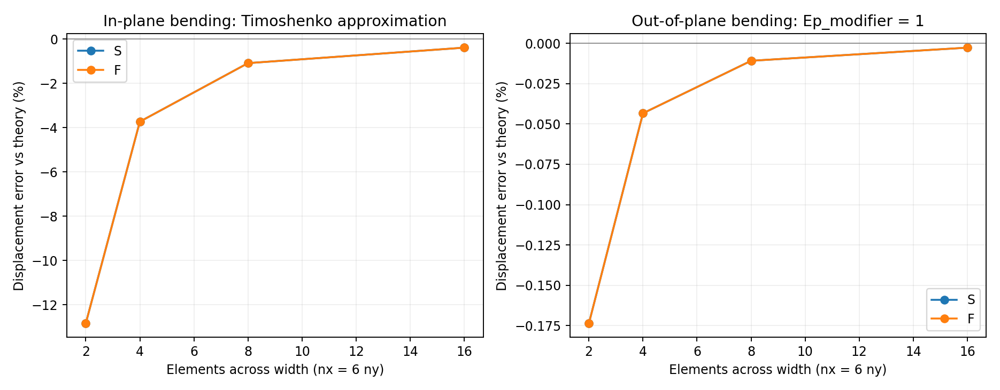
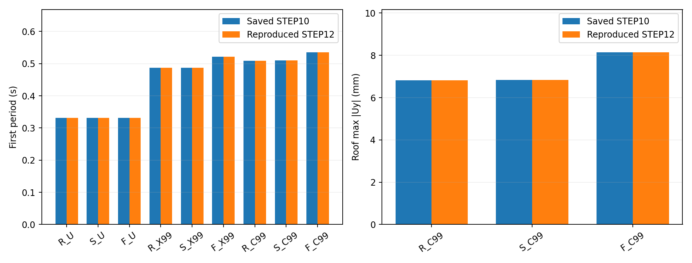
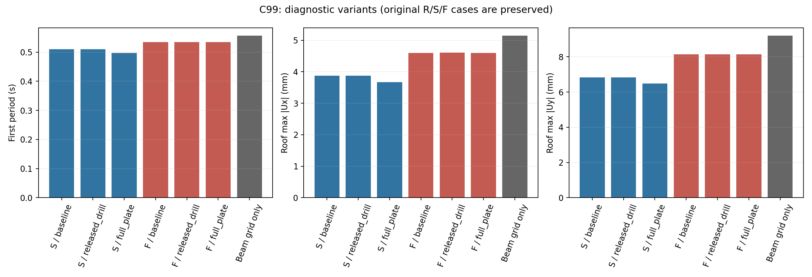

# STEP12·STEP13 — ShellMITC4 구현 검증과 바닥판 비교조건의 타당성

작성일: 2026-10-17. 단위: kN–m–s. 기존 STEP01~11 및 R/S/F×12질량배치는 보존했다.

## 1. 판정

기존 ShellMITC4 모델은 의도한 **면내 탄성강성 비교용 모델**로 동작했다. 설치된 OpenSees에서 인장·압축·전단 패치시험, 질량행렬 시험, Ep_modifier=0의 면외 복원력 0을 확인했다. 기존 대표 고유주기 9개와 C99의 X/Y 변위 6개가 재현되었다. 기존 결과를 변경해야 하는 구현 오류는 이번 검사에서 발견하지 않았다.

단, “바닥판 면내강성만 달라진다”는 설명에는 다음 조건을 붙여야 한다.

- S/F는 면내 구성강성뿐 아니라 ShellMITC4의 **드릴링 회전 안정화 강성**도 E에 따라 달라진다. 보와 셸이 공유한 Rz에 이 안정화가 연결된다.
- R과 S/F는 자유도·구속 방식과 보의 요소 분할수가 다르다. R은 층 전체 Ux/Uy/Rz의 강체 구속, S/F는 유한 면내강성의 변위장이다.
- 현재 세 모델 사이에 **추가된 셸의 직접적인 면외 판 휨·횡전단강성 차이는 없다**. R에는 셸이 없고 S/F는 해당 강성이 0이다.
- 실제 슬래브의 수직 지지·판 휨·편심 합성단면 효과까지 포함한 모델은 아니다. 면내와 면외 물성이 같은 완전한 등방성 판도 아니다.
- 면내구속이 보·기둥의 결합을 통해 전체 골조의 수직 유연도에 간접적으로 영향을 줄 수는 있다. 직접 판 휨강성 0과 전체 골조 수직응답 동일은 다른 명제다.

이 판정은 수치 구현 검증이다. S/F의 물성이 실제 바닥판을 대표한다는 물리적 검증은 아직 남아 있다.

## 2. 사용 버전과 공식 근거

실행환경은 Python 3.10.0, OpenSeesPy/openseespywin 3.5.1.3, OpenSees 핵심 3.5.1, NumPy 2.2.6, SciPy 1.15.3이다.

공식 문서:

- [ElasticMembranePlateSection](https://openseespydoc.readthedocs.io/en/latest/src/elasticMembranePlateSection.html): 마지막 선택 인자 Ep_modifier와 E_plate 관계.
- [ShellMITC4](https://openseespydoc.readthedocs.io/en/latest/src/ShellMITC4.html): 3D·6자유도·반시계방향 4절점.
- [rigidDiaphragm](https://openseespydoc.readthedocs.io/en/latest/src/rigidDiaphragm.html): 평면 강체 다점구속과 Transformation 처리.
- [elasticBeamColumn](https://openseespydoc.readthedocs.io/en/latest/src/elasticBeamColumn.html): 요소 선밀도 기본값 0.

구현 보조 근거는 OpenSees 공개 v3.5.0의 [단면 소스](https://github.com/OpenSees/OpenSees/blob/v3.5.0/SRC/material/section/ElasticMembranePlateSection.cpp) 및 [셸 소스](https://github.com/OpenSees/OpenSees/blob/v3.5.0/SRC/element/shell/ShellMITC4.cpp)다. 설치 바이너리 3.5.1의 정확한 빌드 커밋과 동일함을 보증하지 않는다. 이 차이를 보완하기 위해 실제 설치 바이너리에서 인자 효과와 응답을 직접 시험했다. 원문 사본·URL·해시는 `results/verification/step12_shell_audit/sources/`에 보존했다.

단면 소스의 `getSectionTangent`는 면내 3×3 구성행렬과 면외 휨·횡전단 성분을 구분한다. 셸 소스의 `Ktt`, `computeBdrill`, `formInertiaTerms`는 각각 드릴링 안정화 및 병진 일관질량의 근거다.

## 3. 현재 모델 구성 및 설정 감사표

| 확인 항목 | 코드 위치(이번 검토 시점) | 확인 결과 |
|---|---|---|
| ShellMITC4 생성·절점순서 | `step08_diaphragm_inplane_sensitivity.py:149` | 좌하→우하→우상→좌상. XY 평면에서 반시계방향, 법선 +Z. 1,152요소 중 역방향 0개 |
| 단면 인자 | 같은 파일 `:113` | `section(..., E, 0.20, 0.12, 0.0, 0.0)`; 마지막 두 값은 rho와 Ep_modifier |
| 부재 강성 | 같은 파일 `:91` 및 `step07_3d_reference_frame.py:108` | 동일한 E,A,Iy,Iz,J. 본모델의 보·기둥에 -mass를 주지 않음 |
| 보–셸 연결 | STEP08 `:123`, `:142`, `:145` | 보와 셸 격자가 일치하도록 보를 분할. 보 위에서는 동일 절점의 모든 자유도 공유 |
| 셸 내부 절점 | STEP08 `:136` | 보 위가 아닌 내부 절점의 Uz/Rx/Ry만 고정. Ep=0에서 사용하지 않는 면외 자유도를 제거 |
| R 구속 | STEP07 `:139`, `:140` | 기준절점 Uz/Rx/Ry 고정, 층 실절점 Ux/Uy/Rz 강체구속. 실절점 Uz/Rx/Ry는 독립 |
| R의 셸 | STEP08 `:37` | 없음. 실제 바닥판 질량·면외강성도 따로 추가하지 않음 |
| 절점 질량 | STEP08 `:86`, STEP10 `:62` | 골조 절점에 X/Y만 질량. STEP10의 재배치는 node mass 값을 교체하며 덧셈하지 않음 |
| 총질량 | `step10_diaphragm_mass_interaction.py:96` | modalProperties와 별도 질량행렬 검사 사용. X/Y 각 61.18297278 kN·s²/m |
| 중력→고유치 | STEP10 `:54`, `:71`, `:96` | 균등 200kN/층을 10단계로 가력, 반력 600kN 검사, loadConst 후 고유치 |
| 정적 관성력 | STEP10 `:123` | 동일한 중력 평형점에서 각 질량×1m/s² 가력. X/Y 방향별 총력 61.18297278kN |
| 구속 처리 | STEP07 `:156`, STEP10 `:98`, STEP08 검증 모듈 | Transformation 사용. 기둥 PDelta, 보 Linear |

| 기준 모델 | 절점 수 | 골조 요소 수 | 셸 요소 수 | 보–셸 공유 절점 수 | 명시적 수직·회전질량 |
|---|---:|---:|---:|---:|---:|
| R | 51 | 87 | 0 | 0 | 0 |
| S, 경간당 8×8 | 1,287 | 444 | 1,152 | 393 | 0 |
| F, 경간당 8×8 | 1,287 | 444 | 1,152 | 393 | 0 |

중력 평형에서 세 모델의 지붕 골조절점 수직변위는 약 −0.0001m로 일치한다. S/F 셸의 중력에 의한 면외 힘·모멘트는 0이었다. 위 질량은 직접 입력한 회전질량이 0이라는 뜻이며, 수평 질점의 배치와 구속변환으로 생기는 층 회전관성까지 0이라는 뜻은 아니다.

## 4. 셸이 실제로 구현하는 강성

면내 막강성은

\[
\mathbf A=\frac{Et}{1-\nu^2}
\begin{bmatrix}1&\nu&0\\\nu&1&0\\0&0&(1-\nu)/2\end{bmatrix}.
\]

면외 판강성과 횡전단강성은, \(\eta=\mathrm{Ep\_modifier}\)일 때

\[
D_{11}=\frac{\eta Et^3}{12(1-\nu^2)},\qquad
K_{xz}=K_{yz}=\frac56\frac{\eta E}{2(1+\nu)}t.
\]

| 단위 폭 단면계수 | S | F | 단위 |
|---|---:|---:|---|
| A11=A22 | 2,500,000 | 2,500 | kN/m |
| A12 | 500,000 | 500 | kN/m |
| A66=Gt | 1,000,000 | 1,000 | kN/m |
| 현재 D11, eta=0 | 0 | 0 | kN·m |
| 현재 횡전단계수, eta=0 | 0 | 0 | kN/m |
| 진단용 D11, eta=1 | 3,000 | 3 | kN·m |
| 진단용 횡전단계수, eta=1 | 833,333.333 | 833.333 | kN/m |

따라서 S/F의 면내강성 비는 1,000이다. 현재 면외강성은 둘 다 0이므로 면외강성 비를 1,000이라 할 수 없다. eta=1인 별도 진단에서만 면외강성도 1,000배 차이가 난다.

**면내 휨과 면외 판 휨은 다르다.** XY 바닥을 평면 안에서 휘게 하면 막 인장·압축응력이 평면 폭에 걸쳐 분포한다. 깊이 b, 두께 t의 등가 수평 보는 \(I_z=tb^3/12\)를 사용한다. 셸의 D11은 수직방향 판 휨 \(Et^3\)에 대응하므로, Ep_modifier=0이라고 면내 휨까지 제거되는 것은 아니다.

드릴링 Rz는 막 변위장의 회전과 연결되는 수치 안정화 자유도다. 공개 소스의 안정화계수 Ktt는 막 구성행렬의 최소 고유값으로 정한다. 이 사례의 nu=0.2에서는 Gt에 해당한다. Ep_modifier=0에서도 남아 있으며, 보와 Rz를 공유하면 보의 면내 휨·기둥 비틀림과 연결된다. 이를 실제 슬래브의 독립적인 회전 스프링 물성으로 해석하지 않는다.

## 5. 독립 단위시험 A~D

시험편은 L=6m, 평면 폭 b=1m, 두께 t=0.12m이다. S/F의 기존 E,nu,t를 그대로 사용했으며, L/b와 하중은 해석해 비교를 위한 수치시험 설정이다. 본모델의 바닥판을 이 시험편으로 교체하지 않았다.

### A. 인장·압축

좌변 Ux=0, 좌하단 Uy=0으로 강체운동만 제거하고 포아송 수축을 허용한다. 모든 절점 Uz/Rx/Ry를 고정하고 Rz는 자유다. 우변에 합계 P=±0.001kN의 등분포 면내 하중을 일관된 절점력으로 가한다.

\[u_x=PL/(Etb).\]

12×2 메시에서 S의 인장 이론·FE 변위는 모두 2.5e−9m, F는 2.5e−6m이다. 압축은 부호가 반대이고 크기가 같다. eta=0/1 모두 동일하다.

### B. 일정 면내 전단변형 패치시험

둘레에 Ux=gamma·y, Uy=0, gamma=1e−5를 가하고 내부 Ux/Uy 및 전체 Rz는 자유롭게 둔다. Uz/Rx/Ry는 제거한다. 이는 자유로운 전단 패널의 하중시험이 아니라 **정확한 일정 전단변형장을 재현하는 시험**이다.

\[Q_{\mathrm{top}}=GtL\gamma.\]

S의 상단 전단반력 합은 이론·FE 모두 60kN, F는 0.06kN이다. A/B 전체의 최대 상대오차는 약 3.6e−13%로 부동소수점 오차 수준이었다.

### C. 면내 휨·전단

좌변 Ux/Uy/Rz를 고정하고 우변에 합계 P=0.001kN의 균등 Uy 하중을 가한다. 모든 Uz/Rx/Ry는 고정한다. 끝단의 폭 가중 평균변위를 다음 Timoshenko 보 근사와 비교한다.

\[
u_y=\frac{PL^3}{3EI_z}+\frac{PL}{\kappa Gtb},\quad
I_z=tb^3/12,\quad\kappa=5/6.
\]

S의 이론값은 3.672e−7m, F는 3.672e−4m이다. 이 식은 클램프 근방의 2D 탄성장과 끝단 하중분포를 완전히 표현하는 해석해는 아니다.

### D. 면외 원통형 판 휨

eta=1인 별도 시험에서 Ux/Uy/Rz를 제거하고 전 폭 Rx=0을 둔다. 좌변 Uz/Ry=0, 우변에 합계 P=0.001kN의 Uz 하중을 가한다. 폭 방향 곡률을 억제한 원통형 판 휨이므로 **Db**를 사용한다. 자유 측변 보의 EI와 혼동하지 않는다.

\[
u_z=\frac{PL^3}{3D_{11}b}+\frac{PL}{(5/6)G_{\mathrm{plate}}tb}.
\]

S의 이론값은 2.40072e−5m, F는 2.40072e−2m이다.

| 메시 nx×ny | C: FE/보 이론 상대오차 | D: FE/원통형 판 이론 상대오차 |
|---|---:|---:|
| 12×2 | −12.8363% | −0.173559% |
| 24×4 | −3.73048% | −0.043390% |
| 48×8 | −1.08931% | −0.010847% |
| 96×16 | −0.38999% | −0.002712% |

S/F의 오차는 같은 메시에서 사실상 같고, 강성비는 1,000으로 재현된다. C의 초기 거친 메시에는 휨을 표현하는 오차가 크다. 96×16의 약 0.39% 차이에는 남은 이산화 및 2D 경계효과·보 이론 근사의 차이가 포함되므로 이를 요소 오류라고 단정하지 않는다. 본모델의 8×8 수렴과 이 길쭉한 시험편의 48×8 오차는 서로 다른 기하·경계조건의 결과다.

현재 eta=0인 판에 면외 하중을 주면 독립 판 휨의 유한 해는 없다. 이를 억지로 수렴시키지 않고, 별도 변위제어 시험으로 Uz=0.001(x/L)²를 가했다. S/F 모두 면외 반력·모멘트가 정확히 0이었다. 따라서 단독 셸의 면외 자유도를 본모델에서 처리해야 하는 이유도 확인된다.



## 6. 질량·드릴링 검증

밀도 rho의 단위는 kN·s²/m⁴이며, 단면의 면밀도는 rho×t이다. ShellMITC4는 병진의 일관질량을 조립하며 직접 회전질량을 넣지 않는다. 2×3m 단일 요소에서 rho=0 및 **진단용 단위 밀도 rho=1**을 시험했다. 단위 밀도는 실제 재료밀도가 아니며 본모델에는 적용하지 않았다.

회전 무질량 때문에 행렬추출 해법이 특이해지지 않도록 모든 자유도에 단위 보조질량을 넣고 추출 후 정확히 뺐다. rho=1이면 X/Y/Z 각 방향의 질량행렬 합은 rho·t·면적=0.72이며, 4절점 일관질량 이론행렬과 일치했다. rho=0이면 셸 질량행렬 전체가 0이다. 회전질량은 두 경우 모두 0이다.

드릴링 시험은 한 셸의 모든 병진과 Rx/Ry를 고정하고 한 절점에 0.001kN·m의 Rz 모멘트를 가했다. 유효 회전강성은 S=375,000kN·m, F=375kN·m로 1,000배이며 eta=0/1에 무관했다. 이 값은 **이 시험의 수치적 안정화 응답**이고 실물 회전접합강성이 아니다.

## 7. 기존 대표 결과 재현

STEP10의 저장된 각 `case_*.json`을 읽어 동일 생성기·질량배치·메시8·중력·PDelta로 재계산했다. 표는 6자리로 반올림한 값이며 원시 비교값은 CSV에 저장했다.

| 질량배치 | R 저장/재계산 | S 저장/재계산 | F 저장/재계산 |
|---|---:|---:|---:|
| U | 0.331977 / 0.331977 | 0.331981 / 0.331981 | 0.331987 / 0.331987 |
| X99 | 0.486638 / 0.486638 | 0.486877 / 0.486877 | 0.521671 / 0.521671 |
| C99 | 0.508622 / 0.508622 | 0.509636 / 0.509636 | 0.534916 / 0.534916 |

| C99 | 지붕 X 최대변위 저장/재계산, mm | 지붕 Y 최대변위 저장/재계산, mm |
|---|---:|---:|
| R | 3.852630 / 3.852630 | 6.819202 / 6.819202 |
| S | 3.876186 / 3.876186 | 6.839740 / 6.839740 |
| F | 4.597157 / 4.597157 | 8.138149 / 8.138149 |

최대 상대차는 약 9.71e−11%였다. 모드 순서나 모델 설정을 변경해 기존값에 맞추지 않았다. 정적 비교는 메시가 다른 경우에도 위치가 일치하는 **지붕 골조절점**을 사용한다. 여기의 변위는 질량×1m/s² 정적 관성력에 대한 추가변위이며 실제 지진 시간이력의 최대값이 아니다.



## 8. STEP13 별도 진단 — 연결·보 격자·면외강성

원본 생성기로 모델을 만든 뒤 **새 OpenSees 도메인만** 바꾸는 별도 코드를 작성했다. 원본 소스와 결과는 수정하지 않았다. 아래 수치는 U/C99 대표 조건으로 한정한다.

| 진단명 | 변경 내용 | 고정한 내용 |
|---|---|---|
| baseline | 기존 S/F 그대로 | 전체 기준 |
| released_drill | 보 위 셸 절점을 복제하고 Ux/Uy만 equalDOF. 셸 Rz를 보 Rz에서 분리 | 질량 위치, 보·기둥 단면, 막강성, 면외강성 0 |
| full_plate | Ep_modifier=1, 셸 내부 Uz/Rx/Ry 고정도 해제 | E,nu,t,rho=0, 질량·중력·공유 연결 |
| no_shell | 셸을 제거, 보 격자 유지. 무연결 내부 절점 제거 | 골조·질량·중력; 보 1분할/8분할 대조 |

released_drill은 실제 접합부 해석해가 아니라 **드릴링 공유의 영향만 식별하는 진단**이다. full_plate는 새 실제 바닥판 모델로 채택한 것이 아니라 현재 제거한 면외강성의 효과를 알아보는 진단이다. 이때 내부 Uz/Rx/Ry 고정을 그대로 두면 판 내부를 지반에 고정하는 오류가 생기므로 반드시 해제했다.

| C99 진단 | T1 (s) | 지붕 X 최대 (mm) | 지붕 Y 최대 (mm) |
|---|---:|---:|---:|
| S baseline | 0.509636 | 3.876186 | 6.839740 |
| S released_drill | 0.509638 | 3.876275 | 6.839836 |
| S full_plate | 0.497183 | 3.668981 | 6.483387 |
| F baseline | 0.534916 | 4.597157 | 8.138149 |
| F released_drill | 0.535166 | 4.604056 | 8.151379 |
| F full_plate | 0.534890 | 4.596650 | 8.137313 |
| 보 격자만 | 0.556277 | 5.144048 | 9.194131 |

해석:

1. F_C99에서 드릴링을 분리하면 T1 +0.0467%, X/Y 최대변위 +0.1501/+0.1626%다. 면내 RMS는 X +0.86%, Y +0.88% 정도 변한다. S_C99의 최대변위 변화는 0.003% 미만이다. 이 대표 전역응답에서는 드릴링 공유가 주요 결과를 지배하지 않았다. 고차모드·국부응력·다른 메시까지 무시할 수 있음을 입증한 것은 아니다.
2. S_C99에 면외 판강성을 켜면 T1 −2.443%, X/Y 최대변위 −5.346/−5.210%다. S_U에서는 T1 −3.114%, X/Y −6.172/−6.299%다. 따라서 실제 슬래브의 전체 강성을 포함하려면 현재 면내 전용 결과를 그대로 대체할 수 없다.
3. F_C99에서 셸을 제거하면 T1 +3.993%, X/Y 최대변위 +11.896/+12.976%다. F는 약한 셸이어도 큰 편심에서는 하중 전달에 기여한다. 균등 U에서 F와 보 격자만의 차이가 매우 작다는 사실을 모든 질량배치로 일반화하면 안 된다.
4. 셸 없는 동일 골조의 보를 1분할에서 8분할로 바꾸어도 U/C99의 주기·골조절점 변위는 부동소수점 오차 수준에서 같았다. 대표응답에서 보 분할 자체의 영향을 배제했다. 셸 내부의 무연결 절점은 제거하여 특이행렬을 만들지 않았다.
5. 셸 제거 전후의 변위 차이는 경로가 재분배된 **전체 응답 차이**다. 이를 셸이 부담한 횡력 또는 셸 강성의 가산 분담률로 바꾸어 해석하지 않는다.



## 9. S 기준값의 물리적 의미와 문헌 등가화

S의 E=2e7kN/m²는 20GPa이고 t=0.12m이다. 현재로서는 **균일·등방성인 막의 수치적 기준**으로 사용할 수 있다. E만 보고 실제 RC 슬래브나 합성 데크를 대표한다고 확정할 수 없다. Ep=0인 만큼 같은 E를 가진 완전한 균일 판이라고 부르는 것도 정확하지 않다. F의 E=2e4kN/m²는 20MPa이며, 실제 재료종류가 아니라 같은 형상의 연구용 저강성 수준이다.

로컬 참고문헌 `reference/3_바닥판 면내강성과 다이어프램 조건 설정에 중요한 논문.pdf`의 Tena-Colunga et al. (2015), Appendix A(PDF 13~14쪽, 인쇄 82~83쪽)를 직접 확인했다. DOI: [10.1016/j.engstruct.2015.03.025](https://doi.org/10.1016/j.engstruct.2015.03.025).

부록은 합성단면의 재료별 E,G와 기하를 변환한 뒤 \(E_{ts}I_{ts}=E_{eq}I_{eq}\), \(G_{ts}A_{s,ts}=G_{eq}A_{s,eq}\)로 휨·전단 강성을 각각 맞춘다. 이는 본 연구에서 참고할 **강성 등가의 원리**다. 해당 논문의 Solid-186용 등가 물성을 ShellMITC4의 E 하나에 그대로 옮길 수 있다는 뜻은 아니다. 휨축이 바닥 평면 내인지 면외인지부터 구분해야 한다.

부록 예제의 Eeq≈202,192.45, Geq≈54,844.92(논문 단위)는 nu=0.2인 단일 등방성 재료의 G=E/[2(1+nu)]와 동시에 일치하지 않는다. ElasticMembranePlateSection은 E,nu로 면내 E와 G를 묶으므로, 실제 등가 직교이방성 또는 서로 다른 휨·전단 보정을 자유롭게 입력하는 단면이 아니다. 실제 시스템에 맞는 다른 단면·요소 또는 보조 부재 조합이 필요한지 목표 강성행렬을 먼저 산정해야 한다.

**Case A — 현재 유지:** 기존 S/F의 등방성 막을 수치적 기준으로 두고 응답 민감도만 주장한다. 명칭은 강체 구속 R, 유한강성 막 S, 저강성 막 F로 설명한다. 강성 배율만으로 실제 다이어프램 분류를 확정하지 않는다.

**Case B — 후속 물성기반 모델:** 바닥 형식을 결정한 뒤 층판의 면내 A11/A22/A12/A66, 필요한 면외 D 및 연결 전달강성, 질량을 실제 자료로 정한다. 기존 36조합과 별도 이름·폴더로 관리한다. 이번 작업에서는 실제 바닥판을 선정하거나 새 재료값을 확정하지 않았다.

## 10. 신뢰 가능한 범위와 남은 검증

| 항목 | 현재 판정 | 남은 확인 |
|---|---|---|
| 입력 E에 따른 막 인장·전단강성 | 이론·FE 일치 | 실제 유효 물성의 근거 |
| 면내 휨 | 메시 수렴 및 보 근사와 합리적 차이 | 다른 형상·지지·국부응력은 별도 검증 |
| Ep=0 효과 | 면외 판 휨·횡전단 복원력 0 | 실제 슬래브를 다룰 때 해당 가정의 채택 여부 |
| 질량 중복 | rho=0, 부재 기본질량0, 절점질량 검사 통과 | 면적분포 질량 도입 시 총질량·회전관성 동시 보존 |
| 대표 주기·변위 재현 | 9주기+6변위 일치 | 36조합 모두의 재계산을 이번에 반복한 것은 아님 |
| 드릴링 공유 | U/C99 전역응답 민감도 작음 | 고차모드·국부응력 및 실제 연결 상세 |
| 기존 상호작용 결론 | 기존 수치모델 범위에서 유지할 근거 확보 | full_plate나 실제 바닥판으로 36조합을 재평가한 것은 아님 |
| 실물 바닥판 대표성 | 미확정 | 바닥판 형식·상세·물성·연결자료 필요 |

## 11. 코드 변경 및 보존

기존 STEP01~11 코드·결과 218개 파일의 SHA-256을 전후 비교했고 변경 파일은 0개였다. 원본 코드 수정이나 원본 결과 재생성은 하지 않았다. 새 파일만 추가했다.

- `step12_shell_audit.py`: 독립 A/B/C/D, 밀도·드릴링, 본모델 감사·재현·보존 검사.
- `step12_source_evidence.py`: 공식 출처 사본·URL·해시.
- `step13_diaphragm_validity.py`: 원본 생성기 호출 후 새 도메인에서만 연결·판강성·셸제거 진단.
- `tests/test_step12_shell_audit.py`: 5개 자동시험. 모두 통과.

원본과 다른 진단 코드의 최소 차이는 다음과 같다. 실제 코드와 결과는 별도 파일에 있다.

```python
# 기존 본모델: 유지
ops.section("ElasticMembranePlateSection", 1, E, nu, t, 0.0, 0.0)
# 보 위 절점은 모든 자유도를 공유한다.
# 보 없는 내부 절점의 Uz/Rx/Ry만 고정한다.

# full_plate 진단: 단면 변경에 맞춰 내부 구속도 함께 해제한다.
ops.section("ElasticMembranePlateSection", 2, E, nu, t, 0.0, 1.0)
for node in interior_nodes:
    for dof in (3, 4, 5):
        ops.remove("sp", node, dof)

# released_drill 진단: 면내 병진은 완전 부착, 드릴링 회전만 분리한다.
ops.node(shell_node, x, y, z)
ops.fix(shell_node, 0, 0, 1, 1, 1, 0)
ops.equalDOF(frame_node, shell_node, 1, 2)
```

위 진단은 기존 모델의 오류 수정본으로 채택한 것이 아니다. 발견된 것은 원본 계산 오류가 아니라 **‘면내강성만 변화’라는 표현에서 드릴링 안정화·자유도 차이를 생략하면 부정확하다는 설명상의 보완점**이다. 기존 문서는 보존하고 이 보고서에 보완 설명을 기록했다.

재현 명령:

```powershell
python -m verification.step12_shell_audit
python -m verification.step12_source_evidence
python -m verification.step13_diaphragm_validity
python -m unittest tests.test_step12_shell_audit -v
```

주요 결과:

- `results/verification/step12_shell_audit/model_audit.csv`
- `results/verification/step12_shell_audit/shell_unit_tests.csv`
- `results/verification/step12_shell_audit/stiffness_scaling.csv`
- `results/verification/step12_shell_audit/reproduction.csv`
- `results/verification/step12_shell_audit/unit_tests.json`
- `results/verification/step13_diaphragm_validity/diagnostic_comparison.csv`
- `results/verification/step13_diaphragm_validity/step13_results.json`

STEP14~16은 이번에 실행하지 않았다. 필요한 자료·평가 정의·우선순위는 [후속계획](STEP13_물리적기준_및_후속계획.md)에 정리했다.
